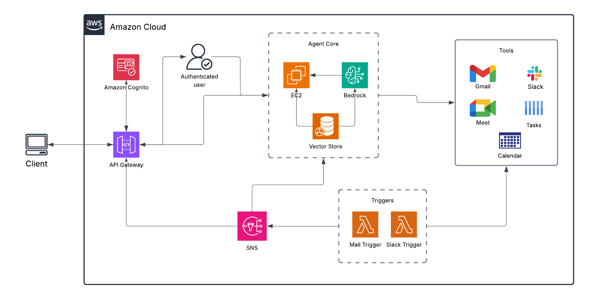

# CPAA – Configurable Personal AI Agent

## Description

CPAA (Configurable Personal AI Agent) is a personal productivity assistant that connects with daily tools such as **Gmail, Google Calendar, Google Meet, and Slack**.
It helps manage **tasks, reminders, and to-do lists** by automatically extracting action items from emails, meetings, and chats.
The agent is **configurable**, allowing users to set custom rules and workflows to suit their individual needs.

---

## Features

* **Integrations**

  * Gmail → Convert important emails into tasks
  * Google Calendar → Sync deadlines and meeting reminders
  * Google Meet → Capture meeting notes and auto-generate tasks
  * Slack → Turn messages into to-do items

* **Task Management**

  * Unified to-do list from multiple sources
  * Automatic reminders and smart notifications
  * Prioritization of tasks based on rules

* **Configurable Agent**

  * Rule-based task creation (e.g., mark `urgent` emails as high priority)
  * Easy integration with future platforms

---

## Architecture

---

## LLM Operating Modes

CPAA supports two selectable intelligence backends via `MODEL_PROVIDER`:

1. **Mode 1: AWS Bedrock Amazon Nova Pro** (`MODEL_PROVIDER=bedrock`)
   - Uses `BedrockModel` from Strands Agents SDK.
   - Recommended model: `apac.amazon.nova-pro-v1:0` (for `ap-south-1` Mumbai / APAC) or `amazon.nova-pro-v1:0` (US/Global).
   - Authenticates via standard AWS IAM credentials (`AWS_ACCESS_KEY_ID`, `AWS_SECRET_ACCESS_KEY`) or EC2 IAM Instance Profiles.

2. **Mode 2: Google Free Tier API** (`MODEL_PROVIDER=google`)
   - Uses `GeminiModel` from Strands Agents SDK.
   - Free tier model: `gemini-2.5-flash` (or `gemini-1.5-flash`).
   - Authenticates via Google AI Studio API key (`GEMINI_API_KEY`).

---

## Deployment on AWS

CPAA is containerized using Docker Compose and automated for deployment on an **AWS EC2** instance:
* **Gateway**: Nginx reverse proxy routing web traffic and webhook traffic
* **Backend**: FastAPI running on Python 3.12 (`cpaa-backend`)
* **Frontend**: Next.js production build (`cpaa-frontend`)
* **Automated CI/CD**: GitHub Actions workflow deploying to AWS EC2 via SSH (`.github/workflows/deploy.yml`)
* **Session Persistence**: Local file session storage or AWS S3 bucket (`S3SessionManager`)
